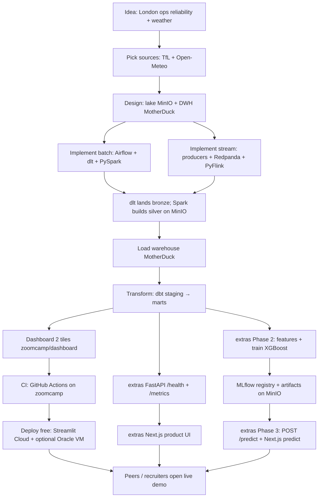
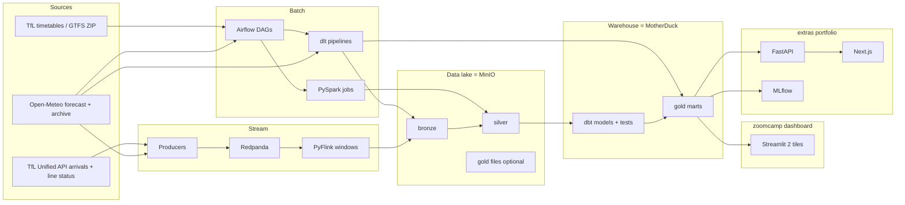
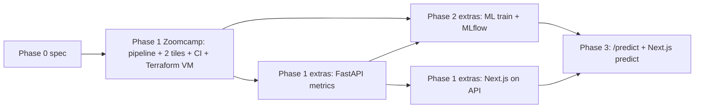
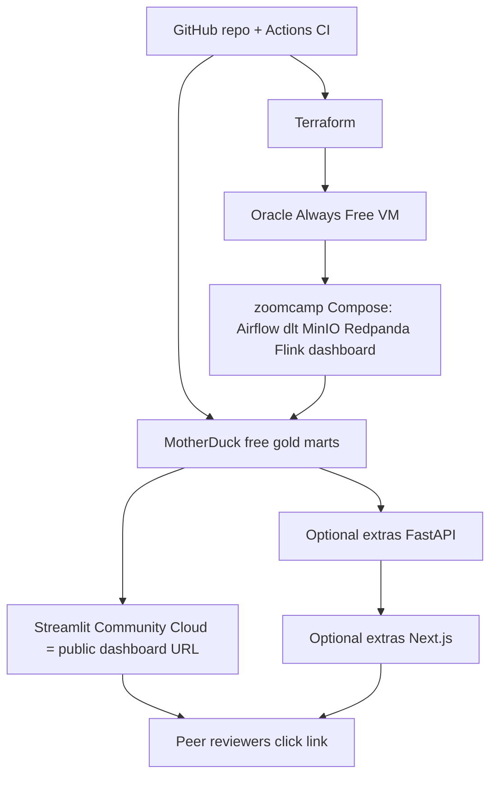

# TransitPulse — Diagrams (idea → deploy → predict)

Simple action / flow diagrams for peers and your future self. Rendered automatically on GitHub (Mermaid).

**Ingest note:** batch/API loads use **dlt**; warehouse transforms use **dbt**; stream path stays Redpanda + PyFlink.

---

## 1. End-to-end action flow (A → Z)

Zoomcamp submit is **A → I → K** (optionally L). Nodes tagged extras are portfolio-only.

---

## 2. Data path (runtime)

---

## 3. Lifecycle phases (when you do what)

Full table: [phases.md](./phases.md).

| Phase | You ship | Not required for Zoomcamp submit |
|-------|----------|----------------------------------|
| **1 Zoomcamp** | Ingest → lake → DWH → dbt → 2 Streamlit tiles + CI + **Terraform free VM** in `zoomcamp/` | FastAPI, Next.js, ML |
| **1 extras API** | FastAPI `/metrics/*` | Graded dashboard |
| **1 extras UI** | Next.js → FastAPI only | Replacing Streamlit for graders |
| **2** | Features, XGBoost, MLflow, batch scores in `extras/ml/` | Public `/predict` |
| **3** | `POST /predict` + Next.js predict view | PyTorch |

---

## 4. Free deploy options (from `cloud-and-free-demo.md`)

---

## How to read this

1. **Diagram 1** = project journey from idea to prediction.
2. **Diagram 2** = where bytes move at runtime.
3. **Diagram 3** = build order.
4. **Diagram 4** = $0 internet presence + Terraform VM path.

Details: [README.md](../README.md) · [PROJECT.md](../PROJECT.md) · [phases.md](./phases.md) · [cloud-and-free-demo.md](./cloud-and-free-demo.md) · [docs index](./README.md)
