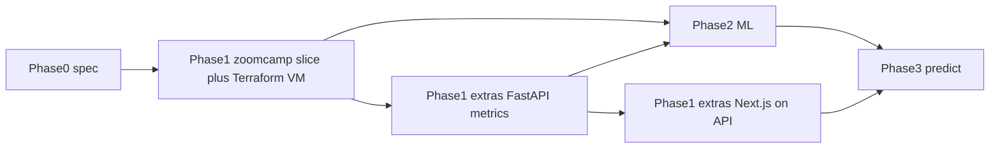

# Phases

Canonical build order. Status of each row: [status.md](./status.md). Serving surfaces: [serving.md](./serving.md). ADR: [0001-extras-nextjs-fastapi.md](./decisions/0001-extras-nextjs-fastapi.md).

Zoomcamp graders review **`zoomcamp/` only**. Next.js is **never** the graded dashboard.

## Table

| Phase | Folder | Ship | Not this phase |
|-------|--------|------|----------------|
| **0** | root + `docs/` | Spec, LAYOUT, agent docs | Pipeline code |
| **1 Zoomcamp** | `zoomcamp/` | One ingest path → MinIO → MotherDuck → dbt → **2 Streamlit tiles** + CI, then **Terraform → Azure credit VM** (`zoomcamp/terraform/`) running **lean** graded Compose | FastAPI, Next.js, ML; stuffing every container onto the VM; Azure Blob as the lake |
| **1 extras API** | `extras/api/` | FastAPI reads **gold marts**: `/health`, `/metrics/lines`, `/metrics/reliability/daily`, `/ops/freshness` | Putting API in zoomcamp Compose |
| **1 extras UI** | `extras/nextjs/` | Next.js product UI that **only** talks to FastAPI (same 2 questions as Streamlit, plus ops/freshness) | Querying MotherDuck from the browser; replacing Streamlit for graders |
| **2** | `extras/ml/` | Feature marts, XGBoost/sklearn, MLflow, batch scores | `/predict` required for Zoomcamp |
| **3** | `extras/api/` + `extras/nextjs/` | `POST /predict`, `/models/active`, Next.js predict view, versioning | PyTorch until classical ML is solid |

## Hard rules

- Graders: `zoomcamp/` only. Streamlit in `zoomcamp/dashboard/` stays the Zoomcamp 2-tile dashboard.
- Next.js **must not** hold a MotherDuck token in the client. Path is **browser → FastAPI → marts**.
- FastAPI stays off `zoomcamp/docker-compose.yml` (separate extras compose later). **Do not** put FastAPI or Next.js on the Phase 1 VM as a grading requirement.
- Phase 1 Zoomcamp **includes** Terraform + one Azure VM paid from a $100 credit (`zoomcamp/terraform/`). Sequence: **laptop slice first**, then `terraform apply`, then lean Compose on the VM (Airflow + dlt + MinIO + Streamlit). Deallocate the VM when idle. Spark/Flink on-demand or screenshots. Details: [cloud-and-free-demo.md](./cloud-and-free-demo.md).
- Do not start Phase 1 extras UI before the metrics API exists (even as a stub against gold).
- Phase 2 does not block Zoomcamp submit. Phase 3 `/predict` uses the same feature contract as batch scores.

## What exists today

Phase **0** is shipped. Phase 1 Zoomcamp laptop slice is **in progress** (see [status.md](./status.md)). Terraform code targets an Azure credit VM and has **not** been applied. Extras phases are not started.
