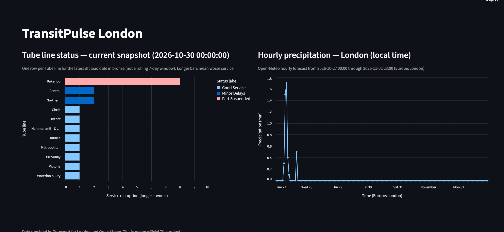

# TransitPulse — Zoomcamp scope

This folder is the **DataTalksClub DE Zoomcamp course project**.

## Graded path

Dataset (TfL + Open-Meteo) → **data lake (MinIO)** → **warehouse (MotherDuck)** → **dbt** → **dashboard (2 tiles)**.

**Batch (this slice):** Airflow DAGs `tube_status`, `weather_hourly`, `arrivals_by_line`, and combined `transit_batch` run dlt into MotherDuck `transitpulse.bronze`. DAG `arrivals_by_line` reloads MinIO silver `arrival_updates` JSON (dlt) and runs dbt `+arrivals_by_line +arrival_updates` (no Flink/Redpanda in the DAG). dbt `--target motherduck` builds staging then mart for each tile: `marts.staging_line_status` → `marts.line_status_snapshot` (`--select +line_status_snapshot`) and `marts.staging_weather_hourly` → `marts.weather_hourly` (`--select +weather_hourly`). The Tube load reads MinIO. The weather load reads `sample_data/`. Use `transit_batch` for one trigger: tube bronze → line-status silver Parquet on MinIO → weather bronze → both staging models and both marts.

**Stream (laptop, partial):** sample arrivals land on Redpanda, and a PyFlink batch aggregate writes local JSON. `lake/arrivals_by_line_to_silver.py` copies the newest `part-*` onto MinIO silver JSON. `lake/arrivals_by_line_to_parquet.py` writes typed Parquet beside that JSON. `ingest/arrivals_by_line_dlt.py` loads that Parquet into MotherDuck `bronze.arrivals_by_line` (line summary; `avg_predicted_seconds` is still TfL predicted seconds). Flink does not write S3 itself. PySpark is not in this slice.



## How to run

Commands below assume you are **in this folder** (`zoomcamp/`).

**Makefile** (same folder):

```bash
make up          # docker compose up -d --build --wait
make test        # uv sync --all-groups && uv run pytest
make dbt-build   # .env next to the Makefile; dbt build (+line_status_snapshot +weather_hourly +arrivals_by_line +arrival_updates + contract test)
```

**As-built (local laptop):**

MinIO lake (API `9000`, console `9001`) + Airflow (`8080`) + Redpanda (Kafka on host `127.0.0.1:19092`):

```bash
cd zoomcamp
cp .env.example .env   # add MINIO_ROOT_USER / MINIO_ROOT_PASSWORD (and other keys)
docker compose up -d --build --wait   # waits until Airflow /health is OK (~1–3 min first start)
docker compose up -d redpanda
docker compose exec redpanda rpk cluster health
docker compose exec redpanda rpk topic create tfl.arrivals -p 1 -r 1
docker compose exec redpanda rpk topic list
# Host Kafka bootstrap: 127.0.0.1:19092 (not localhost on this Windows host — IPv6/wslrelay)
uv run python ingest/publish_sample_arrivals.py
uv run python ingest/consume_sample_arrivals.py
docker compose exec redpanda rpk topic consume tfl.arrivals -o start -n 2 -f 'key=%k%n%v%n'
# PyFlink (Java 17+; download Kafka connector JAR — see stream/jars/README.md):
uv run python stream/print_arrivals_sample.py
uv run python stream/print_arrivals_topic.py   # Redpanda up; reads tfl.arrivals once (bounded)
uv run python stream/print_arrivals_by_line.py # batch SQL: one row per line_id (avg predicted sec)
uv run python stream/write_arrivals_by_line.py # same aggregate → stream/output/arrivals_by_line/
uv run python stream/write_arrival_updates.py  # one JSON row per prediction → stream/output/arrival_updates/
uv sync
uv run python lake/upload_bronze.py   # host → http://localhost:9000
uv run python lake/line_status_to_silver.py   # bronze JSON → silver Parquet (DuckDB); uses 127.0.0.1 if localhost fails
uv run python lake/arrivals_by_line_to_silver.py  # newest part-* → silver/arrivals_by_line/…json
uv run python lake/arrival_updates_to_silver.py   # newest part-* → silver/arrival_updates/…json
uv run python lake/arrivals_by_line_to_parquet.py  # JSON lines → typed Parquet; JSON object stays
uv run python ingest/arrivals_by_line_dlt.py  # that Parquet → MotherDuck bronze.arrivals_by_line (loads .env)
uv run python ingest/arrival_updates_dlt.py   # event JSON → Parquet → bronze.arrival_updates (loads .env)
# Console: http://localhost:9001 → bucket transitpulse → bronze/…, silver/line_status/…, and silver/arrivals_by_line/…
# Airflow UI: http://127.0.0.1:8080 — login admin / admin (override AIRFLOW_WWW_USER / AIRFLOW_WWW_USER_PASSWORD in .env)
# On this Windows host, http://localhost:8080 is reset (IPv6 localhost hits wslrelay). Use 127.0.0.1.
# Unpause DAG transit_batch (or tube_status / weather_hourly / arrivals_by_line separately)
```

Airflow runs in Docker (not on Windows natively). The repo is mounted at `/opt/transitpulse/zoomcamp`; DAG tasks use `http://minio:9000` for the lake. Keep `MINIO_ENDPOINT=http://localhost:9000` in `.env` for host commands.

MotherDuck warehouse path (export token before dlt, dbt, and dashboard):

```bash
cd zoomcamp
uv sync
set -a && source .env && set +a && export motherduck_token="$MOTHERDUCK_TOKEN"
uv run python ingest/weather_hourly_dlt.py
uv run python ingest/tfl_line_status_dlt.py   # MinIO up for lake read
cd transitPule_dbt
uv run dbt run --profiles-dir . --target motherduck --select +line_status_snapshot +weather_hourly --no-partial-parse
uv run dbt test --profiles-dir . --target motherduck --select line_status_snapshot weather_hourly
cd ..
uv run streamlit run dashboard/app.py
```

Local file `data/transitpulse.duckdb` is for dbt **dev** only. **dlt** loads bronze into MotherDuck `transitpulse.bronze.*`; dbt **motherduck** builds staging tables and marts in schema `marts`. Streamlit reads **MotherDuck marts only** — graded tiles: `line_status_snapshot`, `weather_hourly`; after the stream slice, a third section charts `arrivals_by_line` (mean predicted seconds by line).

Tests (no `.env` required):

```bash
cd zoomcamp
uv sync --all-groups
uv run pytest
```

**CI also runs** (no MotherDuck token, no `.env`, no Airflow webserver): `dbt parse --target dev`; `docker compose config --quiet` with `MINIO_ROOT_USER=ci` / `MINIO_ROOT_PASSWORD=ci`; `DagBag('dags')` in `apache/airflow:2.10.4-python3.12` with the repo mounted at `/opt/transitpulse/zoomcamp`.

**Target (not all shipped yet):**

```bash
cd zoomcamp
cp .env.example .env   # TFL_APP_KEY, MOTHERDUCK_TOKEN, MinIO keys
docker compose up -d
# Airflow → dlt → dbt → open dashboard/ (2 tiles)
```

`.env.example`, Compose, dbt, and Terraform (`terraform/` — Phase 1 Azure credit VM) all live **here**, not at the repo root.

**Terraform (Azure VM, $100 credit):**

```bash
az login
cd zoomcamp/terraform
cp terraform.tfvars.example terraform.tfvars   # subscription id, your IP, SSH public key; file is gitignored
terraform init
terraform validate
# spends the credit: terraform plan && terraform apply
```

Details: [terraform/README.md](terraform/README.md) · [docs/cloud-and-free-demo.md](../docs/cloud-and-free-demo.md).

The VM is applied (`austriaeast`, zone 1, `Standard_B2s_v2`). MinIO, Airflow, and a successful `tube_status` run are recorded in [docs/azure-vm-move.md](../docs/azure-vm-move.md), including the laptop SSH tunnels (Airflow `:8081`, MinIO `:19001`). Deallocate the VM when idle.

Living docs: [docs/zoomcamp.md](../docs/zoomcamp.md) · [docs/cloud-and-free-demo.md](../docs/cloud-and-free-demo.md) · [docs/status.md](../docs/status.md)

## Out of scope here

See `../extras/` for FastAPI (backend), Next.js (product UI), ML/`/predict` — **not required for peer grading**.
